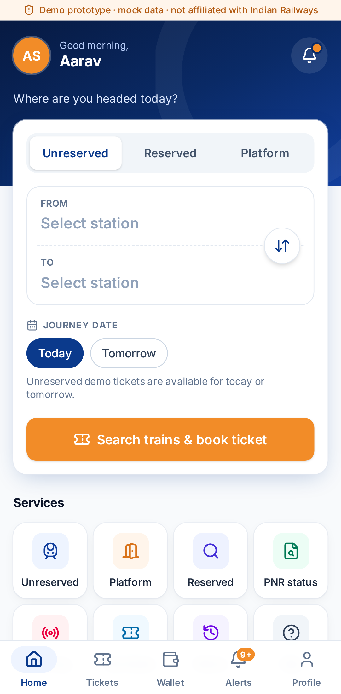
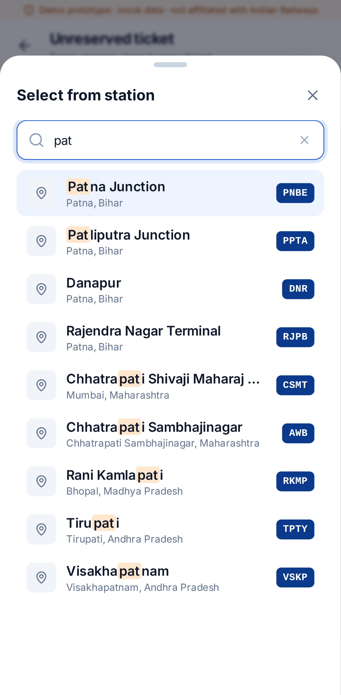
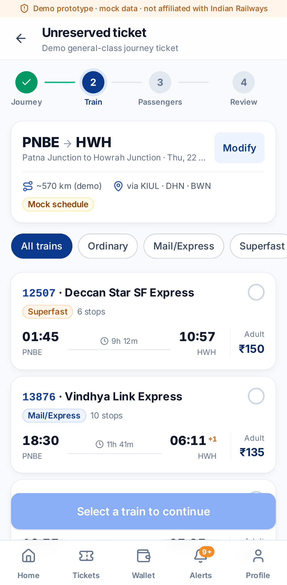
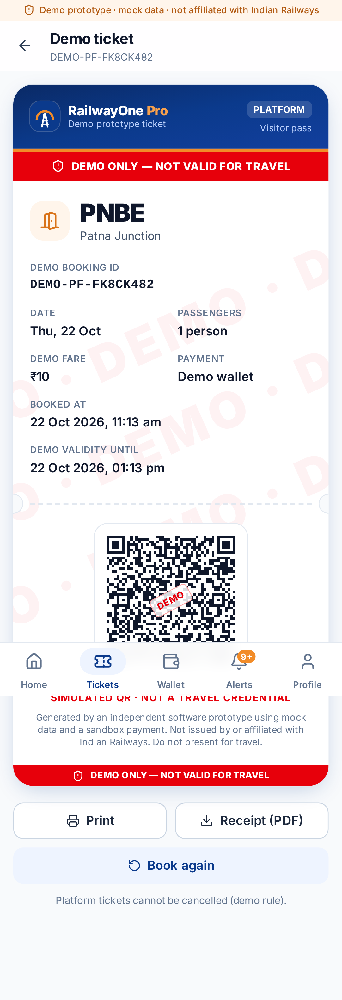
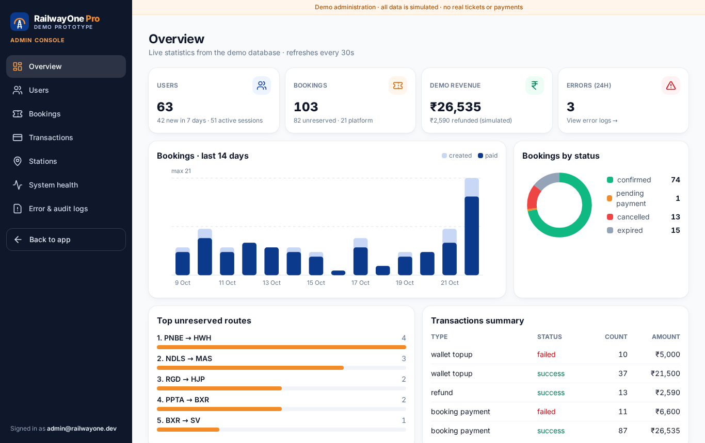

# RailwayOne Pro 🚆 — demo railway booking prototype

> ## ⚠️ DEMO ONLY — NOT VALID FOR TRAVEL
> RailwayOne Pro is an **original, independent prototype** for demonstrating a railway booking user experience.
> It is **not** affiliated with, endorsed by or connected to Indian Railways, CRIS, IRCTC or RailOne. It uses none of their logos, assets or APIs.
> All stations, trains, PNRs, running status, fares and payments are **sample or simulated data**.
> Every ticket, QR code and receipt it produces is marked **“DEMO ONLY — NOT VALID FOR TRAVEL”** and must never be used as a travel credential.
> No real money moves: payments use a built-in sandbox simulator.

A full-stack, installable PWA: React + TypeScript + Vite + Tailwind on the front end; Node + Express + TypeScript + PostgreSQL + Prisma on the back end.

| Mobile home | Station search | Mock trains | Demo ticket | Admin overview |
|---|---|---|---|---|
|  |  |  |  |  |

---

## Features

**Traveller app** (bottom navigation on phones, navy sidebar on tablet and desktop):
- **Home:** greeting, profile shortcut, and a journey card with Unreserved, Reserved and Platform tabs, From/To with swap, and date chips. Also quick actions, recent demo bookings, wallet and help.
- **Unreserved ticket wizard:** journey → mock train/route → passengers (live server-side fare quote) → review with a required demo acknowledgement → sandbox checkout (15-minute hold) → ticket.
- **Platform ticket:** ₹10 per person, valid for 2 hours.
- **Reserved search:** mock class availability and days of run.
- **PNR status** and **running status**, both simulated.
- **Station search:** dataset-backed autocomplete by name, city or code, with codes shown beside names. Popular stations, recent searches (localStorage) and graceful handling of unknown stations.
- **Ticket detail:** booking ID, route, date, passengers, fare, timestamps, a *simulated* QR with a DEMO overlay, and a prominent warning banner. Includes a print-friendly layout, a **downloadable PDF receipt** and a **cancellation simulation** with a refund preview.
- **My tickets** (active/past), **booking history** (filters), and a **wallet** with demo top-ups and a transaction ledger.
- **Profile and settings**, including PWA install. Also **notifications**, **help and support** (FAQ search plus a demo support form), and **login/register**.
- Skeleton loaders, empty and error states, inline validation, toasts, accessible forms (labels, `aria-*`, keyboard listbox, 44px+ touch targets, focus rings) and reduced-motion support.

**Admin console** (`/admin`, role `ADMIN` only):
- Overview KPIs with SVG charts.
- Users (search, filter, enable/disable), bookings, transactions.
- **Station dataset management** (add/edit).
- System health (database latency, memory, migrations).
- Error and audit logs.
- All lists have search, filters and pagination.

**Backend:**
- REST API with zod validation and a consistent error shape `{ error: { code, message, details?, requestId } }`.
- scrypt password hashing and httpOnly session cookies (only an HMAC of the token is stored).
- RBAC middleware, CSRF header check, Helmet CSP, and rate limiting (global, auth and payments).
- **Server-side fare calculation** from a clearly versioned demo fare table.
- Payment simulator, audit logging, error logging (server and client), Prisma migrations and an idempotent seed.

See **[docs/API.md](docs/API.md)** for the full API reference.

---

## Quick start (local development)

Requirements: **Node.js ≥ 20.19**, npm 10, and **PostgreSQL 14+**. Postgres can be local or run via Docker.

```bash
# 1. Install dependencies (npm workspaces: server + web)
npm install

# 2. Configure the environment
cp .env.example .env
#    then set SESSION_SECRET to a long random value:
node -e "console.log(require('crypto').randomBytes(48).toString('hex'))"

# 3. Start PostgreSQL (pick one)
docker compose up -d db                      # Postgres 17 on localhost:5432 (matches .env.example)
# or create a local role/db: user railway / pw railway_dev_pw / db railwayone

# 4. Create the schema and load the demo data
npm run db:deploy      # apply migrations (use db:migrate while developing the schema)
npm run db:seed        # 132 sample stations, demo + admin accounts, sample history (re-runnable)
```

### Run the backend and frontend (two terminals)

```bash
# Terminal 1 — API (Express + tsx watch) on http://localhost:4000
npm run dev:server

# Terminal 2 — Web app (Vite dev server) on http://localhost:5173  (proxies /api → :4000)
npm run dev:web
```

Open **http://localhost:5173** and sign in with a seeded account, or use the one-tap buttons on the login screen:

| Role | Email | Password |
|---|---|---|
| Traveller | `demo@railwayone.dev` | `Demo@12345` |
| Admin | `admin@railwayone.dev` | `Admin@12345` |

(These come from the `SEED_*` variables in `.env`. Change them for any shared deployment.)

### Production-style run (single port)

```bash
npm run build          # server → server/dist, web → web/dist (with service worker)
npm start              # Express serves the API and the built PWA on http://localhost:4000
```

### Docker Compose (whole stack)

```bash
export SESSION_SECRET=$(node -e "console.log(require('crypto').randomBytes(48).toString('hex'))")
docker compose up --build
# → http://localhost:4000   (migrations + idempotent seed run on container start)
```

> The Dockerfile and compose file use standard images (`node:20-bookworm-slim`, `postgres:17-alpine`), but they weren't run in the environment this project was built in. The same steps were verified natively instead.

---

## Sandbox payment cheat sheet

| Method | Succeeds | Declines |
|---|---|---|
| Demo UPI | `success@demoupi` (any `name@demoupi`) | IDs starting with `fail`, e.g. `fail@demoupi` |
| Demo card | `4111 1111 1111 1111`, `5555 5555 5555 4444` | `4000 0000 0000 0002` |
| Demo wallet | When the balance is enough | When the balance is too low |

For cards, any future `MM/YY` expiry and any 3-digit CVV work. Only the last 4 card digits are stored. Sample PNRs: `2451837690`, `4120985563`, `8347201196`. Sample trains for running status: `12345`, `13021`, `12801`, `15273`.

## Demo rules (enforced on the server)

- **Fare table `DEMO-FARE-2026.1`:** distance slabs (`server/src/domain/fareTable.ts`). Surcharges: Ordinary ₹0, Mail/Express ₹15, Superfast ₹30.
  - Adult fare = max(₹10, rounded up to ₹5); child fare = half base + surcharge.
- **Unreserved tickets:** 1–4 passengers with at least one adult; journeys for today or tomorrow (IST) only; source ≠ destination.
- **Cancellation:** confirmed, still-valid unreserved tickets only. The refund is the total minus ₹15 clerkage per passenger, credited to the demo wallet. Platform tickets can't be cancelled.
- **Payment hold:** unpaid bookings expire after 15 minutes.
- **Wallet top-ups:** ₹100–₹10,000 each, up to a ₹20,000 balance.

---

## Tests

```bash
npm test                  # server (Vitest: unit + API integration) then web (Vitest + Testing Library)
npm run test:e2e          # Playwright e2e against http://localhost:4000 (build + seed first)
npm run typecheck         # strict TypeScript, both workspaces
```

| Suite | What it covers |
|---|---|
| `server/tests/unit/fare.test.ts` | Fare slabs, surcharges, child fares, rounding, platform fares, refunds |
| `server/tests/unit/stations.test.ts` | Station search ranking, code/name/city matching, unknown input |
| `server/tests/unit/journey.test.ts` | Journey validation: same station, date window, passenger limits |
| `server/tests/unit/payment.test.ts` | Simulated payments: Luhn, expiry, CVV, UPI rules, declines, wallet balance |
| `server/tests/integration/api.test.ts` | Auth, RBAC, CSRF header, booking → pay → cancel, validation errors, admin endpoints |
| `web/src/components/__tests__/StationPicker.test.tsx` | Station selection UI: popular, autocomplete, keyboard, recents, excluded station, errors |
| `web/src/lib/__tests__/*.test.ts` | Client validation, recent searches, IST dates, payment input, open-redirect guard |
| `web/e2e/*.spec.ts` | Full unreserved booking with failed then successful payment, DEMO ticket and cancellation; platform ticket; RBAC; admin; session lifecycle |

The integration tests use an **isolated Postgres schema** (`rw1_test`, or `DATABASE_URL_TEST`), which is migrated and seeded automatically. They never touch your dev data.

For Playwright, install a browser once with `npx playwright install chromium`, or point `PLAYWRIGHT_BROWSERS_PATH` at an existing install. Set `E2E_BASE_URL` to test another host.

---

## Project layout

```
railwayone-pro/
├─ server/                     Express + Prisma API
│  ├─ prisma/                  schema.prisma, migrations/, seed.ts
│  ├─ data/stations.sample.json   ← replaceable station dataset (+ stations.schema.json)
│  ├─ src/config/env.ts        validated env vars (refuses to start without secrets)
│  ├─ src/domain/              pure logic: fare, fareTable, stationSearch, journey, trains, payment, qr, pnr, runningStatus
│  ├─ src/middleware/          auth/RBAC, CSRF header, rate limits, validation, errors, request IDs
│  ├─ src/services/            bookings/payments, sessions, audit, receipts (PDF), station cache
│  ├─ src/routes/              auth, stations, journey, bookings, account, admin, system
│  └─ tests/                   unit + integration
├─ web/                        React PWA
│  ├─ src/components/ui/       design-system primitives (Button, Card, Field, Sheet, Badge, …)
│  ├─ src/components/          AppShell, StationPicker, TicketCard, QRCode, PaymentMethods, …
│  ├─ src/pages/               traveller screens          src/admin/  admin console
│  ├─ src/lib/                 api client, formatting, IST dates, validation, recents
│  └─ e2e/                     Playwright specs
├─ docs/API.md · docs/screenshots/
├─ Dockerfile · docker-compose.yml · docker/entrypoint.sh
└─ .env.example
```

### Replacing the station dataset
Edit or replace `server/data/stations.sample.json`. It must conform to `stations.schema.json`: `code, name, city, state, zone, lat, lng, isPopular`. Then re-run `npm run db:seed`, which upserts stations by code. Admins can also add or edit stations at `/admin/stations`.

## Environment variables

| Variable | Purpose |
|---|---|
| `DATABASE_URL` | PostgreSQL connection string |
| `SESSION_SECRET` | ≥32 characters, used to HMAC session tokens. **Required**; the example value is rejected in production. |
| `SESSION_TTL_HOURS` | Session lifetime (default 72) |
| `CORS_ORIGINS` | Comma-separated allowed browser origins |
| `COOKIE_SECURE` | `true` behind HTTPS |
| `TRUST_PROXY` | Number of proxy hops to trust for client IPs |
| `FRAME_ANCESTORS` | CSP `frame-ancestors` (default `'self'`) |
| `RATE_LIMIT_MAX`, `AUTH_RATE_LIMIT_MAX`, `PAYMENT_RATE_LIMIT_MAX` | Rate-limit budgets |
| `WEB_DIST_DIR` | Built web app served by Express (default `../web/dist`) |
| `SEED_DEMO_*`, `SEED_ADMIN_*` | Credentials for the seeded demo accounts |
| `DATABASE_URL_TEST` | Optional separate database for integration tests |

## Security notes
- No secrets are hard-coded: config is validated at boot, and `.env` is git-ignored.
- Passwords use scrypt with a per-user salt. Changing a password revokes other sessions. Disabled users lose their sessions.
- Cookies are `httpOnly` and `SameSite=Lax`, with `Secure` configurable. Mutations also require the `X-RW1-Client` header.
- Helmet sets a strict CSP (no third-party origins). Request bodies are limited to 32 KB.
- Payment card data is never stored beyond the last 4 digits, and no real payment provider is contacted.
- Audit log entries record logins, registrations, bookings, payments, refunds, top-ups and admin changes.

## Licence
MIT for the code in this repository. Station names and codes are public geographic references, used here as sample data only.
